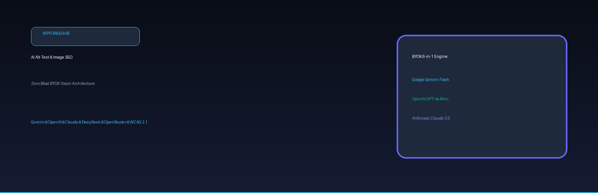

# ForgeHub AI Alt Text

<p align="center">
  
</p>

[](https://www.gnu.org/licenses/gpl-2.0.html)
[](https://github.com/WpForgeHub/forgehub-ai-alt-text/releases/tag/v1.2.0)
[](https://php.net/)
[](https://wordpress.org/)
[](https://wordpress.org/)
[](https://wordpress.org/plugins/)
[](https://wpforgehub.com/)
[](https://wpforgehub.com/)
[](https://wpforgehub.com/)


<p align="center">
  <a href="https://github.com/WpForgeHub/forgehub-ai-alt-text/releases/latest/download/forgehub-ai-alt-text-free.zip">
    
  </a>
  <a href="https://wpforgehub.com/product/ai-alt-text/">
    
  </a>
</p>


> ⚡ **Generate WCAG-compliant image Alt-Text, Titles, Captions, and Descriptions directly from your WordPress Media Library using your own AI API keys.**

---

## 🌟 Why AI Alt Text?

Most AI plugins for WordPress charge recurring middleman markup fees and route your images through external proxy servers. **AI Alt Text** changes the game with a 100% private **BYOK (Bring Your Own Key)** architecture:

* **Zero Middleware:** Your server connects directly to your chosen AI provider using native WordPress APIs.
* **Virtually Free Operations:** Use Google Gemini's generous free tier or OpenAI's GPT-4o-mini for fractions of a penny per image.
* **Selectable Metadata:** Choose exactly which fields you want AI to generate: Alt Text, Image Title, Caption, or Description.
* **Smart Overwrite Policy:** Never worry about overwriting your hand-crafted editorial captions or custom titles.
* **Under 50 KB Footprint:** Zero external CDN dependencies, zero bloated JavaScript frameworks. Pure performance.

---

## 🤖 Supported AI Providers (6-in-1 Engine)

1. **Google Gemini:** `gemini-1.5-flash`, `gemini-2.0-flash`, `gemini-1.5-pro` *(Ultra-fast & free tier quota)*
2. **DeepSeek:** `deepseek-flash` *(Native Multimodal Vision)*, `deepseek-v4-pro` *(Deep reasoning)*, `deepseek-chat`
3. **OpenAI:** `gpt-4o-mini`, `gpt-4o` *(Industry standard vision)*
4. **Anthropic Claude:** `claude-3-5-haiku`, `claude-3-5-sonnet` *(Most natural copy)*
5. **OpenRouter:** Connect 100+ open vision models with a single API key
6. **Custom Endpoint:** Connect your local `Ollama`, `Groq`, or `vLLM` server
* **Custom Models:** Don't want to use standard presets? Type any custom model identifier manually!

---

## 🚀 Free vs. PRO Feature Matrix

| Feature | FREE (Community) | PRO |
| :--- | :---: | :---: |
| **Media Library 1-Click Alt-Text** | ✅ | ✅ |
| **All 6 AI Providers (BYOK)** | ✅ | ✅ |
| **Multi-Language Output (EN, TR, DE, ES, FR, IT)** | ✅ | ✅ |
| **Custom Model Manual Entry** | ✅ | ✅ |
| **Multi-Field Selection (Alt, Title, Caption, Desc)** | ✅ | ✅ |
| **Preserve Manual Edits (Overwrite Policy)** | ✅ | ✅ |
| **Brand & Niche Context Guidance** | ✅ | ✅ |
| **Bulk Alt-Text Scanner** | ✅ (Up to 20/run) | **✅ (Unlimited / 10,000+)** |
| **Instant Upload Automation (`add_attachment`)** | ❌ | **✅ Automatic** |
| **WooCommerce Context (Title, SKU, Category)** | ❌ | **✅ Deep SEO** |
| **Priority Developer Support** | ❌ | **✅ Included** |

---

## 💎 PRO Pricing & Licensing

| Plan Tier | Monthly | Annual (Best Value) | Lifetime | Ideal For |
| :--- | :--- | :--- | :--- | :--- |
| **Single Site (1 Site)** | $3.99 / mo | **$19 / yr** | $39 *(One-time)* | Individual blog or business site |
| **5 Sites** | $7.99 / mo | **$39 / yr** | $79 *(One-time)* | Freelancers & web developers |
| **Unlimited Sites** | $12.99 / mo | **$69 / yr** | $129 *(One-time)* | Agencies & multi-site networks |

👉 **[Get PRO on WPForgeHub](https://wpforgehub.com/product/ai-alt-text/)** — Instant license delivery, automatic updates, and 14-day money-back guarantee.

---

## 📦 Installation

### Option 1: Direct Download (Easiest)
1. Download the latest release: [forgehub-ai-alt-text-free.zip](https://github.com/WpForgeHub/forgehub-ai-alt-text/releases/latest/download/forgehub-ai-alt-text-free.zip).
2. In your WordPress admin, navigate to **Plugins &rarr; Add New Plugin &rarr; Upload Plugin**.
3. Choose the downloaded ZIP file and click **Install Now**, then **Activate**.

### Option 2: Clone via Git
```bash
cd wp-content/plugins/
git clone https://github.com/WpForgeHub/forgehub-ai-alt-text.git
```

### Setup in 60 Seconds
1. Go to **Settings &rarr; AI Alt-Text (BYOK)** in your WordPress sidebar.
2. Select your provider (e.g. Google Gemini or DeepSeek) and paste your API key.
3. Open **Media &rarr; Library**, click any image, and click **⚡ Generate with AI**!

---

## 🛡️ Security & Coding Standards

* 100% compliant with official **WordPress.org Plugin Guidelines**.
* Strict Nonce and `manage_options` / `upload_files` capability validation.
* Pure input sanitization (`sanitize_text_field`, `esc_url_raw`) and output escaping (`esc_html`, `esc_attr`).
* Licensed under **GPLv2 or later**.

---

## 🌐 WPForgeHub Ecosystem

Crafted with care by the **[WPForgeHub](https://wpforgehub.com)** team.
* Website: [https://wpforgehub.com](https://wpforgehub.com)
* GitHub: [@WpForgeHub](https://github.com/WpForgeHub)
* Support: `support@wpforgehub.com`
